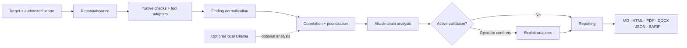

<div align="center">
  <h1>NEXUS</h1>
  <p><strong>Network EXploration &amp; Unified Security</strong></p>
  <p>AI-optional orchestration for authorized penetration tests and security assessments.</p>
  <p>
    <a href="https://github.com/chaithaya632/nexus-i/actions/workflows/ci.yml"></a>
    
    <a href="LICENSE"></a>
    
  </p>
  <p><code>Reconnaissance</code> · <code>Assessment</code> · <code>Correlation</code> · <code>Attack-path analysis</code> · <code>Reporting</code></p>
</div>

---

NEXUS is a modular penetration-testing orchestration framework that brings Python-native security checks, established scanner integrations, finding correlation, attack-chain analysis, controlled validation, and structured reporting into one engagement workflow.

It is designed to **coordinate existing security tooling, not replace it**. NEXUS combines its own checks with tools such as Nmap, Nuclei, OWASP ZAP, and SQLMap, then stores results in a shared engagement context for correlation, review, and reporting.

The assessment and correlation pipeline does not require a hosted AI service, an LLM, or a GPU. Local Ollama integration is optional.

## Contents

- [Core capabilities](#core-capabilities)
- [How it works](#how-it-works)
- [Requirements](#requirements)
- [Installation](#installation)
- [Quick start](#quick-start)
- [Scan profiles](#scan-profiles)
- [Integrations](#integrations)
- [Scope and safety controls](#scope-and-safety-controls)
- [Reports and CI/CD](#reports-and-cicd)
- [Dashboard and proxy](#dashboard-and-proxy)
- [Configuration](#configuration)
- [Docker](#docker)
- [CLI reference](#cli-reference)
- [Development](#development)
- [Operational notes](#operational-notes)
- [License](#license)

## Core capabilities

| Capability | What NEXUS provides |
|---|---|
| **Reconnaissance** | Subdomain, DNS, port (including `-Pn` and firewall-tolerant fallback), service, technology, WAF, and OSINT workflows through native modules and external-tool adapters. |
| **Security assessment** | HTTP/TLS checks, security-header and cookie analysis, exposure checks, passive DAST, API specification checks, GraphQL checks, and network-service probes. |
| **Finding correlation** | Deduplication, severity prioritization, CVE/CWE/OWASP enrichment, and comparison of engagement results against a baseline. |
| **Knowledge base** | Bundled CVE and CISA KEV data, remediation references, passive YAML rules, and attack-chain templates. |
| **Attack-path analysis** | Weighted attack-chain graphs derived from assessment findings and built-in or reusable YAML templates. |
| **Controlled validation** | Optional exploit-tool integrations (Hydra, SQLMap, Nmap `vulners` CVE verification, offline JWT header audit, and MSFBridge) with explicit operator confirmation before active execution. |
| **Evidence and reporting** | Markdown, HTML, PDF, DOCX, JSON, and SARIF 2.1.0 exports; Nessus XML, Burp Suite XML, and CSV import support. Credential passwords and hashes are redacted in report exports. |
| **Engagement operations** | Persistent SQLite storage, optional PostgreSQL, an optional FastAPI dashboard, WebSocket progress events, and a passive HTTP proxy. |
| **Local AI assistance** | Optional Ollama-based analysis. Core scanning, rule processing, and correlation remain usable without an LLM. |

## How it works

An engagement moves through a consistent sequence. Operators can run the complete workflow or execute individual phases.



The rule-based core uses bundled knowledge and deterministic processing. Network reconnaissance and scanning still require network access to the authorized target, and external integrations require their respective binaries to be installed.

## Requirements

- Python **3.11 or newer**.
- Linux, macOS, or Windows for the Python application.
- Network access to the assessment target for remote reconnaissance and scanning.
- Optional third-party security tools installed and available on `PATH` for the integrations you intend to use.

NEXUS's native Python checks work without installing the external scanners. Availability of individual tool integrations varies by operating system and local installation.

## Installation

### Install the core package

```bash
git clone https://github.com/chaithaya632/nexus-i.git
cd nexus-i

python -m venv .venv
```

Activate the environment:

```bash
# Linux / macOS
source .venv/bin/activate

# Windows PowerShell
.venv\Scripts\Activate.ps1
```

Install NEXUS:

```bash
python -m pip install --upgrade pip
pip install -e .
```

### Install optional components

Install only the extras required for your environment:

| Extra | Enables | Install command |
|---|---|---|
| `report` | PDF and DOCX report generation | `pip install -e ".[report]"` |
| `dashboard` | FastAPI dashboard, API, and repeater | `pip install -e ".[dashboard]"` |
| `ai` | Ollama client integration | `pip install -e ".[ai]"` |
| `ml` | scikit-learn support | `pip install -e ".[ml]"` |
| `browser` | Playwright-based browser crawling | `pip install -e ".[browser]"` |
| `proxy` | mitmproxy capture integration | `pip install -e ".[proxy]"` |
| `postgres` | PostgreSQL persistence | `pip install -e ".[postgres]"` |
| `full` | All optional Python extras above | `pip install -e ".[full]"` |

These extras install Python dependencies. They do **not** install every third-party security binary listed under [Integrations](#integrations).

## Quick start

### 1. Initialize NEXUS

Detect the available hardware tier and create the default configuration under `~/.nexus/`:

```bash
nexus init
```

### 2. Define the authorized scope

Create a `scope.yaml` file. Replace the example entries with assets that you are explicitly authorized to assess.

```yaml
allowed_domains:
  - app.example.com
  - "*.app.example.com"

allowed_ips:
  - 192.0.2.10

allowed_cidrs:
  - 192.0.2.0/24

excluded_targets:
  - production.example.com

allowed_ports:
  - 22
  - 80
  - 443
  - 8080

notes: "Authorized assessment scope"
```

### 3. Run a non-exploitation engagement

Pass a bare domain, hostname, or IP address (without `http://` or `https://`) to `engage` and `recon`:

```bash
nexus engage app.example.com \
  --scope scope.yaml \
  --profile web \
  --no-exploit
```

NEXUS prints the engagement ID when the run completes. Use that ID to inspect or export the results.

### 4. Review and export findings

```bash
# List saved engagements
nexus engagements list

# Export a human-readable HTML report
nexus report --engagement <ENGAGEMENT_ID> --format html

# Export SARIF for code-scanning systems
nexus report --engagement <ENGAGEMENT_ID> --format sarif --output nexus-results.sarif
```

### 5. Run active validation only when authorized

The exploitation phase asks for operator confirmation by default:

```bash
nexus exploit --engagement <ENGAGEMENT_ID>
```

Use `--no-exploit` on `nexus engage` when active validation is not part of the assessment. The `--yes` flag and `NEXUS_AUTO_CONFIRM_EXPLOITS=true` suppress the confirmation prompt; use them only in controlled, explicitly authorized workflows.

## Scan profiles

Choose a profile based on the target and the intended depth of assessment.

| Profile | Focus |
|---|---|
| `quick` | Lightweight checks, including headers, exposure, TLS, targeted Nuclei checks, and network audits. |
| `web` | Web application assessment, crawling, WAF checks, GraphQL and authentication-difference checks, plus web scanner integrations. |
| `network` | Network-oriented discovery, OSINT, TLS/SSH checks, and network-service audits. |
| `api` | API-oriented web assessment, crawling, OpenAPI input, GraphQL and authentication-difference checks. |
| `full` | Broadest configured workflow across web, network, and reconnaissance modules. |

The selected profile controls which modules NEXUS schedules. Results also depend on target reachability, supplied authentication, local tool availability, and the scope configuration.

## Integrations

NEXUS combines native Python checks with optional external tools. External binaries are detected on `PATH`; integrations are skipped when the required executable is unavailable.

| Workflow | Integrations |
|---|---|
| **Reconnaissance** | Nmap, Subfinder, Amass, ProjectDiscovery `httpx`, WhatWeb, DNSx, `dig`, wafw00f, theHarvester |
| **Web and network assessment** | Nuclei, ffuf, Nikto, Katana, WPScan, SSLyze, ssh-audit, NetExec (`nxc`), OWASP ZAP |
| **Traffic inspection** | mitmproxy through `nexus proxy` |
| **Host audit** | `dpkg-query`, `rpm`, SSH-based package inventory |
| **Validation** | SQLMap, Hydra, Nmap `vulners`, Metasploit (`msfconsole`) |
| **Import** | Nessus XML, Burp Suite XML, CSV |

### Native checks

The following checks are implemented in NEXUS and do not depend on the corresponding external scanner binaries:

- TLS certificate validity, expiry, and negotiated protocol inspection.
- HTTP security headers, cookie attributes, CORS, and Content Security Policy checks.
- Signature-verified checks for exposed paths and services such as `/.git`, `/.env`, Spring Actuator, and `/metrics`.
- Passive HTML/JavaScript inspection, client-side secret extraction, GraphQL introspection, and authentication-difference checks.
- OpenAPI/Swagger specification auditing and offline JWT header auditing (`alg: none` and weak HMAC algorithms).
- Declarative passive HTTP inspection using bundled YAML rules, including OWASP Top 10:2021-aligned categories (`110` rules).
- Native socket and HTTP probes for services including Redis, FTP, MongoDB, PostgreSQL, MySQL, SMTP, etcd, Consul, Kubelet, Elasticsearch, Docker API, and Memcached.

Some checks, including SMB and SSH auditing and package inventory, use external system tools. See the integration modules under `nexus/scanner/` for implementation details.

## Scope and safety controls

NEXUS is intended for authorized security testing. Scope boundaries are part of the engagement workflow, not an optional reporting label.

- **Target-scoped by default:** when an engagement is created without a `scope.yaml` file (see [Quick start](#2-define-the-authorized-scope)), NEXUS builds a boundary around the specified target.
- **Explicit scope files:** `scope.yaml` can define allowed domains, IP addresses, CIDR ranges, excluded targets, and permitted ports.
- **Lab-only unrestricted mode:** `--unrestricted-scope` or `NEXUS_UNRESTRICTED_SCOPE=true` disables the default target boundary. Use this only in an isolated lab under your control.
- **Confirmation-gated exploitation:** active exploitation requires operator confirmation unless explicitly overridden with `--yes` or `NEXUS_AUTO_CONFIRM_EXPLOITS=true`.
- **Tamper-evident audit trail:** actions are written to a SHA-256 hash-chained JSONL log. Verify the chain with `nexus audit verify`.
- **Protected dashboard binding:** when the dashboard listens beyond loopback, configure `NEXUS_DASHBOARD_TOKEN` or pass a token.

> **Proxy scope note:** `nexus proxy` uses the supplied `--scope` file or the selected engagement's scope. When neither is supplied, intercepted traffic is recorded without scope filtering. Pass `--scope` or `--engagement` when scoped capture is required.

## Reports and CI/CD

### Report formats

| Format | Intended use |
|---|---|
| Markdown (`md`) | Review in source control and documentation workflows |
| HTML | Shareable, self-contained assessment report |
| PDF | Print-ready report (requires the `report` extra) |
| DOCX | Editable report (requires the `report` extra) |
| JSON | Structured engagement data; credential passwords and hashes are redacted |
| SARIF 2.1.0 | Security finding interchange and GitHub Code Scanning |

### GitHub Actions

NEXUS includes a composite action (`action.yml`) that runs a scoped engagement, exports SARIF, and can compare the result with a previous baseline.

```yaml
name: NEXUS security assessment

on:
  workflow_dispatch:

permissions:
  contents: read
  security-events: write

jobs:
  scan:
    runs-on: ubuntu-latest
    steps:
      - uses: actions/checkout@v4

      - name: Run NEXUS
        uses: chaithaya632/nexus-i@main
        with:
          target: app.example.com
          scope_file: scope.yaml
          profile: api
          sarif_output: nexus-results.sarif
          # Optional regression gate:
          # baseline_id: <PREVIOUS_ENGAGEMENT_ID>
          # fail_on_new: critical,high

      - name: Upload SARIF to GitHub Code Scanning
        if: always() && hashFiles('nexus-results.sarif') != ''
        uses: github/codeql-action/upload-sarif@v3
        with:
          sarif_file: nexus-results.sarif
          category: nexus
```

The action does not upload SARIF itself; the separate upload step publishes the generated file to GitHub Code Scanning. The included action runs with `--no-exploit`. A `baseline_id` must refer to an engagement present in the database used by that CI run; a fresh ephemeral runner will not automatically have records from an earlier run.

## Dashboard and proxy

Install the dashboard and proxy extras when you need these components:

```bash
pip install -e ".[dashboard,proxy]"
```

Start the local dashboard:

```bash
NEXUS_DASHBOARD_TOKEN="<LONG_RANDOM_TOKEN>" \
  nexus dashboard --host 127.0.0.1 --port 8477
```

Start the passive HTTP proxy with an explicit scope:

```bash
nexus proxy --host 127.0.0.1 --port 8080 \
  --scope scope.yaml \
  --engagement <ENGAGEMENT_ID>
```

The dashboard exposes REST endpoints, WebSocket progress events, proxy-history inspection, and a scope-enforced HTTP repeater. Keep it bound to loopback unless remote access is intentionally configured and protected with a token.

## Configuration

NEXUS reads defaults from `~/.nexus/config.yaml`. Environment variables override the corresponding configuration values.

| Variable | Purpose | Default |
|---|---|---|
| `NEXUS_DATA_DIR` | Runtime data and audit directory | `~/.nexus` |
| `NEXUS_DB_PATH` | SQLite database path | `<NEXUS_DATA_DIR>/nexus.db` |
| `NEXUS_DB_URL` | PostgreSQL connection string | SQLite |
| `NEXUS_DB_KEY` | Key used to encrypt stored credentials | Backend-managed fallback when not set |
| `NEXUS_PROFILE` | Default scan profile | `full` |
| `NEXUS_STEALTH` | Scan-behavior profile (concurrency, pacing, and rotation) | `medium` |
| `NEXUS_TIER` | Resource tier | Auto-detected |
| `NEXUS_MAX_THREADS` | Maximum concurrent tasks | `5` |
| `NEXUS_OUTPUT_DIR` | Default report output directory | `./nexus_output` |
| `NEXUS_KNOWLEDGE_DIR` | Custom knowledge directory | Bundled knowledge base |
| `NEXUS_IGNORE_FILE` | Default `.nexusignore` path | Not set |
| `NEXUS_LOCAL_PKG_AUDIT` | Enable read-only local package audit | `false` |
| `NEXUS_UNRESTRICTED_SCOPE` | Disable default target scope (lab use only) | `false` |
| `NEXUS_AUTO_CONFIRM_EXPLOITS` | Suppress active-exploitation confirmation | `false` |
| `NEXUS_AUTH_LOGIN_URL` | Stateful login endpoint | Not set |
| `NEXUS_WPSCAN_API_TOKEN` | WPScan API token | Not set |
| `NEXUS_DASHBOARD_TOKEN` | Dashboard authentication token | Not set |
| `NEXUS_ZAP_PATH` | OWASP ZAP executable path | `zap.sh` |
| `NEXUS_OLLAMA_HOST` | Local Ollama API endpoint | `http://127.0.0.1:11434` |
| `NEXUS_MODEL` | Ollama model name | `dolphin-mistral` |

Hardware detection assigns a resource tier based on available RAM (`minimal`, `light`, `standard`, or `full`). Core scanning and correlation do not require a GPU. Ollama inference performance depends on the model and the local CPU/RAM/GPU available to Ollama.

## Docker

The repository includes a Dockerfile that installs the Python package, all optional Python extras, and a curated set of external security tools. The container runs as an unprivileged `nexus` user (`HOME=/home/nexus`, `NEXUS_DATA_DIR=/home/nexus/.nexus`).

```bash
docker build -t nexus-pt .
mkdir -p nexus-data output

docker run --rm \
  -e NEXUS_DATA_DIR=/work/data \
  -e NEXUS_OUTPUT_DIR=/work/output \
  -v "$PWD/nexus-data:/work/data" \
  -v "$PWD/output:/work/output" \
  -v "$PWD/scope.yaml:/work/scope.yaml:ro" \
  nexus-pt engage app.example.com \
    --scope /work/scope.yaml \
    --profile web \
    --no-exploit
```

If you override the container UID with `--user "$(id -u):$(id -g)"` to match host bind-mount ownership, also set `-e HOME=/tmp` because `/home/nexus` (which stores pre-warmed Nuclei templates built into the image) is owned by UID `nexus`. The Docker image includes a curated integration set; it does not imply that every tool listed in [Integrations](#integrations) is bundled.

## CLI reference

| Command | Purpose |
|---|---|
| `nexus --version` | Print the installed version |
| `nexus init` | Detect hardware and initialize configuration |
| `nexus engage TARGET` | Create and run an engagement |
| `nexus recon TARGET` | Run reconnaissance and create or resume an engagement |
| `nexus scan TARGET -e ID` | Run the scan phase for an existing engagement |
| `nexus exploit -e ID` | Run the confirmation-gated exploitation phase |
| `nexus report -e ID -f FORMAT` | Export an engagement report |
| `nexus diff OLD NEW` | Compare engagements and optionally fail on new findings |
| `nexus engagements list` / `show ID` / `delete ID` | Manage saved engagements |
| `nexus kb stats` / `search QUERY` / `sync` / `import-kev` / `import-nvd` | Inspect or update the knowledge base |
| `nexus ai status` / `setup` | Inspect or configure optional Ollama integration |
| `nexus proxy` | Start passive HTTP capture |
| `nexus dashboard` | Start the FastAPI dashboard |
| `nexus audit verify` | Verify audit-log chain integrity |
| `nexus version` | Print NEXUS version and detected hardware tier |

Run `nexus --help` or `nexus <command> --help` for the complete option list.

## Development

Install the development dependencies:

```bash
pip install -e ".[dev,dashboard,report]"
```

Run tests and static checks:

```bash
pytest tests/ -v
ruff check nexus/ tests/
ruff format --check nexus/ tests/
```

The CI workflow runs tests and Ruff checks on Python 3.11, 3.12, and 3.13. The Docker build and smoke test run on pushes to `main`.

### Repository layout

```text
nexus/
├── ai/          # Optional Ollama client, prompts, and analysis guards
├── brain/       # Rules, CVE/KEV data, knowledge graph, and chain templates
├── cli/         # Click commands and Rich terminal interface
├── core/        # Configuration, scope enforcement, audit, engine, and phases
├── correlator/  # Finding deduplication, enrichment, prioritization, and diffs
├── dashboard/   # Optional FastAPI API, WebSockets, proxy history, and repeater
├── db/          # Pydantic models, SQLite store, optional PostgreSQL backend
├── exploit/     # Confirmation-gated validation adapters
├── plugins/     # Plugin loader
├── recon/       # Reconnaissance modules and tool runners
├── reporter/    # Markdown, HTML, PDF, DOCX, JSON, and SARIF generators
├── scanner/     # Native checks, scanner adapters, and importers
├── stealth/     # Request pacing and related scan controls
└── main.py      # CLI entry point

tests/           # Pytest suite organized by subsystem
```

## Operational notes

- **Alpha software:** command options, configuration, and integrations may change between revisions.
- **Tool availability:** `pip install -e .` installs the NEXUS Python package, not the full ecosystem of external security tools.
- **Assessment quality:** coverage and signal quality depend on the selected profile, target responses, authentication context, rule data, and installed tools. Review and validate findings before treating them as confirmed vulnerabilities.
- **Operational impact:** active scanning and exploitation can affect availability or modify target state. Obtain written authorization and agree on testing windows before running assessments.
- **Secrets:** protect dashboard tokens, authentication material, database keys, and local NEXUS data files as sensitive assessment data.

## License

NEXUS is distributed under the [MIT License](LICENSE).
